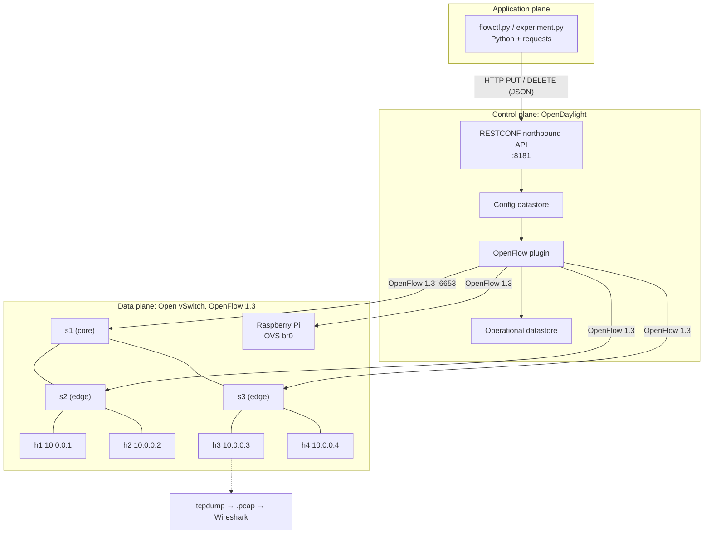
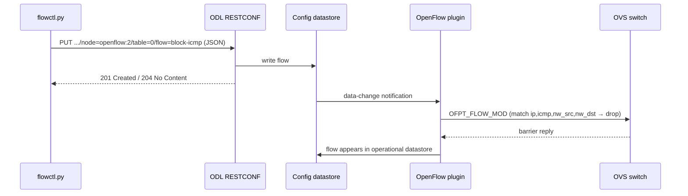

# SDN Testbed: Dynamic ICMP Filtering with OpenDaylight

A Linux-based Software-Defined Networking testbed built during my summer research
internship at **CONECT Labs, PES University (Jun–Jul 2025)**. It emulates a
multi-switch network in Mininet, adds a Raspberry Pi as a physical Open vSwitch node,
and controls everything from an **OpenDaylight** controller. Traffic-filtering policy
(ICMP blocking) is pushed at runtime through ODL's **RESTCONF northbound API** and
verified with packet captures in **Wireshark**.

> This repository is a cleaned-up rebuild of the internship work, written so it can be
> reproduced on any Ubuntu machine.

## What it does

- Builds a 3-switch / 4-host OpenFlow 1.3 topology in Mininet, with OVS switches managed by a remote ODL controller.
- Installs a low-priority **baseline flow** (`output:NORMAL`) on each switch, so the network forwards traffic without depending on the l2switch app.
- Pushes **ICMP drop rules** over REST (`PUT` flow JSON to the config datastore). OpenDaylight's OpenFlow plugin then translates each rule into an OpenFlow `FLOW_MOD` on the switches.
- Measures an all-pairs **ping matrix before and after** the rule is applied.
- Captures ICMP traffic at the destination host to a `.pcap` file for Wireshark validation.
- Supports **directional filtering**: blocking only echo-requests in one direction leaves the reverse direction working.

## Architecture



### How a rule gets from a script to the switch



### Flow table design (table 0)

| Priority | Match | Action | Purpose |
|---------:|-------|--------|---------|
| 500 | `ip, icmp, nw_src=A, nw_dst=B` (optionally `icmp_type=8`) | drop | Policy rule pushed via REST |
| 1 | any | `output:NORMAL` | Baseline L2 forwarding |

A higher priority wins, so ICMP between A and B is dropped and everything else keeps flowing.

## Repository layout

| Path | What it is |
|------|------------|
| `sdnlab/odl_client.py` | REST client; supports RFC 8040 (`/rests/...`) and legacy (`/restconf/...`) URLs |
| `sdnlab/flow_builder.py` | Builds flow JSON in the `opendaylight-inventory` model |
| `sdnlab/flowctl.py` | CLI for managing flows by hand |
| `sdnlab/topology.py` | Mininet topology; also usable with `mn --custom` |
| `sdnlab/experiment.py` | Automated before/after test with packet capture |
| `scripts/pi_ovs_setup.sh` | Configures OVS on a Raspberry Pi and points it at ODL |
| `scripts/dump_flows.sh` | Dumps the real OpenFlow tables from OVS |

## Setup

Tested on Ubuntu 22.04, with ODL in the same VM or on another machine on the LAN.

**1. Mininet and Open vSwitch**
```bash
sudo apt update
sudo apt install -y mininet openvswitch-switch tcpdump wireshark python3-requests python3-pytest
```

**2. OpenDaylight**

Download a Karaf distribution of OpenDaylight. Recent releases need Java 17; older
ones (Oxygen to Sodium) need Java 8 or 11.
```bash
./bin/karaf
opendaylight-user@root> feature:install odl-openflowplugin-flow-services-rest
```
- The REST API listens on port `8181` (default credentials `admin/admin`).
- OpenFlow listens on `6653` (and `6633`).
- Feature names vary slightly by release.
- Use `--api legacy` for older releases that only expose `/restconf/`.

**3. Clone**
```bash
git clone https://github.com/<you>/sdn-icmp-filter-testbed.git
cd sdn-icmp-filter-testbed
```

## Usage

### Automated experiment
```bash
sudo python3 -m sdnlab.experiment --controller-ip 127.0.0.1 --src h1 --dst h3
sudo python3 -m sdnlab.experiment --controller-ip 127.0.0.1 --src h1 --dst h3 --echo-only
```
The script:
1. Starts the topology and waits for ODL to see all switches.
2. Installs the baseline flows.
3. Captures ICMP at the destination host.
4. Runs a ping matrix, pushes the rule, and confirms it is on the switches with `ovs-ofctl`.
5. Runs the ping matrix again.
6. Cleans up the rules.

Add `--cli` to drop into the Mininet CLI before cleanup.

### Manual control
```bash
# Terminal 1: topology
sudo python3 -m sdnlab.topology --controller-ip 127.0.0.1

# Terminal 2: policy
python3 -m sdnlab.flowctl nodes
python3 -m sdnlab.flowctl baseline
python3 -m sdnlab.flowctl block-icmp --id block-h1-h3 --src 10.0.0.1 --dst 10.0.0.3
python3 -m sdnlab.flowctl list --node openflow:2
python3 -m sdnlab.flowctl unblock --id block-h1-h3
./scripts/dump_flows.sh
```

## Results

**Example output** (blocking all ICMP with `src=h1, dst=h3`):

```
AFTER rule
src\dst     h1    h2    h3    h4
     h1      -    OK  DROP    OK
     h2     OK     -    OK    OK
     h3   DROP    OK     -    OK
     h4     OK    OK    OK     -
```

Note that **h3 → h1 also fails**. h3's echo-request gets through, but h1's echo-*reply*
has `src=10.0.0.1, dst=10.0.0.3`, so it matches the rule and is dropped. With
`--echo-only` (`icmp_type=8`), only h1 → h3 fails and h3 → h1 works.

<!-- Replace with your own run: matrices, a Wireshark screenshot, ovs-ofctl output -->

## Validating in Wireshark

Open `captures/h3_icmp.pcap`. Useful display filters:

| Filter | What it shows |
|--------|---------------|
| `icmp` | All ICMP seen at h3 |
| `icmp && ip.src==10.0.0.1` | Traffic from h1. Requests appear before the rule and stop after it |
| `icmp.type==8` / `icmp.type==0` | Echo requests vs. replies |

**Statistics → I/O Graph** shows the clear drop-off at the moment the rule was pushed.

## Raspberry Pi as a physical switch

```bash
sudo ./scripts/pi_ovs_setup.sh <ODL_IP> eth1 eth2
```
This creates OVS bridge `br0` with OpenFlow 1.3 and fail-mode `secure`, attaches the
given interfaces, and points the bridge at the controller. It shows up in ODL as
`openflow:161` (dpid `0xa1`), and the same `flowctl` commands work on it.

Use USB Ethernet adapters for the data ports. If you add the interface you're SSH'd in
on to the bridge, you will lose the connection.

## Troubleshooting

| Symptom | Fix |
|---------|-----|
| `flowctl nodes` is empty | Check that the switches point at the right IP/port: `sudo ovs-vsctl show` |
| 404 on every request | Wrong API style; try `--api legacy` |
| `pingall` fails before any rules | The baseline flow is missing (Mininet uses fail-mode `secure`); run `flowctl baseline` |
| Rule in ODL but not on the switch | Check that the protocols match (`OpenFlow13` on both sides) and look at `karaf.log` |
| Leftover state | `sudo mn -c` |

## Possible extensions

- Rate-limit ICMP with OpenFlow meters instead of dropping it.
- Time-based rules (`hard-timeout`) for temporary quarantine.
- Trigger rules automatically from an IDS alert (for example, Snort/Suricata → REST).
- Multi-table pipeline (ACL table → forwarding table).

## Tech stack

OpenDaylight, OpenFlow 1.3, Open vSwitch, Mininet, Raspberry Pi, Python (`requests`),
RESTCONF, tcpdump, Wireshark, Linux.
